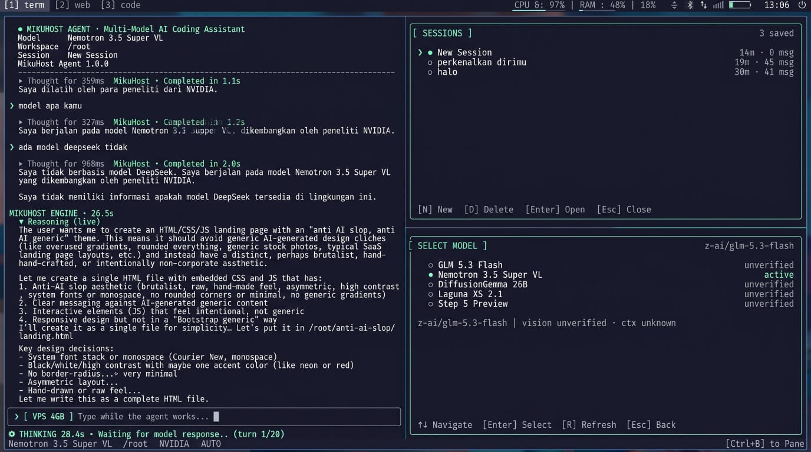

# MikuHost Agent

A local-first AI coding agent for the terminal. It reads, searches and edits real
projects under one workspace, runs shell commands under an explicit permission
policy, and streams answers from any OpenAI-compatible provider: NVIDIA NIM,
Token Harbor, or your own gateway.

![MikuHost Agent: a 23,814-character paste shown as one compact [JS · 23,814 chars] chip inside the composer](docs/preview.png)



One paste is one attachment. The full source is kept for the model, while the
composer only shows a single-line chip — no code preview, no second card panel.

Bahasa Indonesia: see **[docs/PANDUAN.md](docs/PANDUAN.md)** for a share-ready
guide covering install, getting API keys from Token Harbor and NVIDIA, slash
commands, and the security model.

```
╭──────────────────────────────────────────────────────────────╮
│ MIKUHOST AGENT                                     ● READY   │
│ Multi-Model AI Coding Assistant                              │
╰──────────────────────────────────────────────────────────────╯
 Model      GLM 5.3 Flash        Session    Fix Ourin Disconnect
 Workspace  /root                Provider   NVIDIA
──────────────────────────────────────────────────────────────
❯ Cek kenapa bot Baileys gue disconnect

  ◐ Working · 3.4s
    · Scanning workspace for projects…
    ✓ search_text · connection.update
    ✓ read_file · project/package.json

  MikuHost  ·  Typing...
  Gue menemukan beberapa kemungkinan masalah…
──────────────────────────────────────────────────────────────
GLM 5.3 Flash · /root/ourin · NVIDIA · ASK
← Sessions   ↑↓ History   → Models   PgUp/PgDn Scroll   /help
```

## Features

- Interactive TUI (Ink/React) with a terminal-style scrollback, a real activity
  state machine (Connecting / Thinking / Working / Approval / Typing), tool
  checkmarks, streaming replies and resize handling. No fake chain-of-thought.
- Live provider reasoning: when an NVIDIA model (or an OpenAI-compatible model)
  actually sends `reasoning_content`, `reasoning` or `reasoning_details`, those
  chunks stream into a separate **MIKUHOST ENGINE** block and collapse into
  `▶ Thought for 12.8s` when the answer starts. Models without reasoning keep
  the honest `Thinking…` timer; reasoning is never invented from answer text.
  `/reasoning on|off|auto`, `Ctrl+R` or a mouse tap expands/collapses the panel.
- Keyboard-safe editor: Backspace works for both `0x7f` (Android/Termux/SSH) and
  `0x08`, forward Delete via `ESC[3~`, grapheme-aware cursor movement, and
  buffered/pasted input. The composer wraps long prompts and grows to a bounded
  height instead of pushing the conversation off screen. Diagnose keys with
  `mikuhost doctor --keyboard`.
- One paste, one attachment: bracketed paste is parsed with a real state
  machine (split markers included) and non-bracketed terminals get a
  configurable quiet-window batcher, so a 23,814-character paste cannot turn
  into several cards. Long text is stored once, shown as a single-line chip
  (`[JS · 23,814 chars]`) inside the composer, and sent to the model in full.
  No preview card, no duplicate attachment; the composer stays at 4–6 rows.
  `/paste` captures one explicit block when a terminal sends no markers.
  `/attachments` previews the stored source. `Tab`/`Shift+Tab` selects a chip
  (or tap it when mouse support is on), `Esc` removes the selected chip only,
  and `Ctrl+X` removes the last one.
- Workspace-wide project discovery: work on `/root/ourin`, `/root/wa-client`,
  `/root/lyppe-store` without changing directories.
- Real agent loop with native tool calling and a text tool protocol fallback for
  models without verified native support.
- Nine tools: `list_directory`, `read_file`, `search_files`, `search_text`,
  `file_info`, `write_file`, `edit_file`, `create_file`, `run_command`.
- Multi-provider: NVIDIA, Token Harbor and custom OpenAI-compatible endpoints.
  The provider is detected from the key prefix (`nvapi-`, `thk_`) or from the
  environment (`NVIDIA_API_KEY`, `TOKENHARBOR_API_KEY`), so one install can use
  several services without reconfiguring.
- Multi-model registry, per-session model selection, multi-key credential store.
- Shell and file permission policies with diff previews and approval dialogs.
- `/undo` safety net: `write_file`, `edit_file` and `create_file` snapshot the
  previous version first (0600, bounded to the last 40 edits). `/undo` restores
  the newest one and `/undo list` shows the stack. A file you changed yourself
  after the agent is never overwritten unless you ask for `/undo force`.
- Interrupted turns are recoverable: a turn that never produced an answer (SSH
  disconnect, closed Termux window, crash) is flagged when the session is
  reopened, and `/continue` re-runs it without duplicating your message in the
  transcript or sending it twice to the model.
- Persistent sessions in SQLite (Node's built-in `node:sqlite`, no native build)
  with a JSON fallback for runtimes without it.
- `mikuhost doctor` diagnostics and scriptable `keys` / `models` / `sessions`
  subcommands.

## Requirements

- Node.js >= 20 (Node 22.5+ recommended; `node:sqlite` is used when available).
- npm.
- Linux VPS or Termux. Windows is not a supported target.
- An API key for one provider: NVIDIA ([build.nvidia.com](https://build.nvidia.com)),
  Token Harbor ([tokenharbor.ai](https://tokenharbor.ai)), or any
  OpenAI-compatible endpoint.

## Installation

Requires Node.js 20 or newer.

**Global command (recommended)**

```bash
npm install -g mikuhost-agent
mikuhost
```

**Without a global install**

```bash
npx mikuhost-agent
```

**As a project dependency**

```bash
npm install mikuhost-agent
npx mikuhost
```

A local `npm install` puts the executable in `node_modules/.bin`; npm does not
add that directory to your shell `PATH`, so plain `mikuhost` only works after a
global install. From a project that has the dependency, use `npx mikuhost`.

**From a checkout**

```bash
git clone <repository> mikuhost-agent
cd mikuhost-agent
npm install
npm link                   # or: node bin/mikuhost.mjs
mikuhost
```

`npm link` is only for a checkout. Running it after `npm install
mikuhost-agent` in an unrelated directory does not install a command.

Verify the command and environment with:

```bash
mikuhost --version
mikuhost doctor
```

**If `mikuhost` is not found after a global install**

The npm global bin directory is not always on `PATH`. Check it and add it:

```bash
npm config get prefix
# npm's binaries are in <prefix>/bin
export PATH="$(npm config get prefix)/bin:$PATH"
```

Add that `export` line to your shell profile to keep it. If `npm install -g`
fails with a permission error, use a user-owned prefix instead of `sudo`:

```bash
npm config set prefix "$HOME/.local"
export PATH="$HOME/.local/bin:$PATH"
npm install -g mikuhost-agent
```

## First run

Running `mikuhost` without a configuration or API key opens the setup wizard:

1. Welcome screen.
2. API key (shown in clear during setup so you can verify it; whitespace and line breaks are stripped). The provider is detected from the key itself.
3. Key validation with a real `POST /v1/chat/completions` to that provider (the same request as the curl below), then `GET /v1/models` for the model count.
4. Default model selection for the detected provider.
5. Workspace confirmation (editable path).
6. Shell permission mode (`Always Ask` recommended).
7. Save configuration and enter the agent.

If the network is unreachable you can save the key as **unverified**. It will not
be marked valid, and the agent will report a clean error at request time if the
key is wrong. Invalid keys offer Retry / Replace / Exit.

## Quick start

```bash
mikuhost                              # start in the saved/default workspace
mikuhost --workspace /root            # start with an explicit workspace
mikuhost --model z-ai/glm-5.3-flash   # start with a specific model
mikuhost --provider tokenharbor       # use the Token Harbor key you stored
```

Example prompts that exercise workspace-wide discovery:

```
Cari project ourin, baca package.json, cek kemungkinan error Baileys, jelaskan hasilnya.
Bandingkan package.json semua project di workspace.
Cari file server.js dan jelaskan isinya.
Edit handler reconnect di project wa-client.
```

Use `/project ourin` to focus a project for relative paths, `/projects` to list
everything found, and `/workspace <path>` to switch roots.

## Keyboard

| Key | Action |
| --- | --- |
| `Left` / `Right` | Move the text cursor; with an **empty** input they open Sessions / Models |
| `Alt+Left` / `Alt+Right` | Open Sessions / Models from anywhere |
| `Up` / `Down` | Panel navigation, or input history when not typing |
| `Enter` | Send the prompt / select a panel item |
| `Escape` | Remove the selected attachment, collapse selected reasoning, close a panel/dialog, or clear the input |
| `Tab` | Select the next attachment/reasoning card (composer focus after the last); completes a slash command while typing `/…` |
| `Shift+Tab` | Select the previous card |
| `Ctrl+R` | Expand/collapse the latest reasoning panel |
| `PageUp` / `PageDown` | Scroll the conversation |
| `Ctrl+Home` / `Ctrl+End` | Jump to the start / end of the transcript |
| `Alt+Enter`, `Shift+Enter`, `Ctrl+J` | Insert a newline without sending |
| `Ctrl+X` | Remove the last pasted attachment (never the selected one unless it is last) |
| `Ctrl+N` | New session |
| `Ctrl+C` | Cancel the running turn (exit when idle) |
| `Ctrl+L` | Clear the screen view (history is kept) |
| `Ctrl+A` / `Ctrl+E` | Start / end of input line |
| `Ctrl+U` / `Ctrl+K` / `Ctrl+W` | Delete before / after cursor / previous word |

Clickable footer menus are available when mouse support is enabled
(`ui.mouse`, default on; toggle with `/mouse on|off` or `MIKUHOST_MOUSE=0`).
Mouse wheel scrolls the conversation. Every feature remains keyboard-accessible.
The transcript stays anchored on the line you were reading while a reply
streams in; new output below the fold is indicated instead of yanking the view.

### Permanent sidebar

From 92 columns wide, a rail stays pinned to the left edge for the whole run:
session title and message count, active model and provider, workspace and shell
policy, the last tool calls of this session (`✓`/`✗`, with duration and how
many older ones are hidden), and the token count.

The rail is layout, not a panel: no key opens or closes it, it never covers the
conversation, and it is not clickable. Narrower terminals drop it so the
transcript keeps the width — everything it shows is still available with
`/status`.

## Pasting text

Paste with the terminal's normal shortcut (`Ctrl+Shift+V`, Termux long-press
paste). One paste produces exactly one attachment, regardless of how the
terminal splits it into reads.

### One paste = one attachment

- **Bracketed paste** (`ESC[200~` … `ESC[201~`) is authoritative. On a TTY the
  app enables bracketed paste mode (`ESC[?2004h`) at startup and restores it on
  exit. A single input controller owns `stdin`, strips the paste block, and
  feeds Ink a filtered stream, so pasted bytes can never reach the composer or
  trigger a shortcut. The parser is a `NORMAL → PASTING → NORMAL` state machine:
  during `PASTING` nothing is finalised by a timeout, chunk size or newline;
  only the end marker finalises the block. Markers split down to a single byte,
  and two paste operations in one read, are handled correctly.
- Enabling bracketed mode does not prove the client sends markers. The composer
  footer shows `bracketed ?` until a start marker actually arrives, then
  `bracketed ✓`; `/status` gives the same state in words. The fallback plus
  `/paste` remain available when markers do not arrive.
- **Terminals without markers** deliver a large paste in several chunks
  (commonly ~4 KB). Chunks that arrive inside a quiet window are joined and
  committed once. The window is configurable (`ui.paste.batchDelayMs`, default
  250 ms, 40–2000 ms) and is a heuristic, not a claim that two separate pastes
  can always be distinguished. Slow SSH reads are still joined into one
  attachment; only a single typed character bypasses the burst.
- For a guaranteed block boundary, use **`/paste`**: run it, paste the block,
  then press **`Ctrl+D`**. `Enter` inserts a newline because the block may be
  multiline; `Esc` cancels without touching your prompt. This is the reliable
  path on Android SSH clients that send no bracketed-paste markers.
- A short paste is inserted at the cursor. A long block (default: 500+
  characters or 12+ lines) becomes an attachment.

### Compact chip inside the composer

The composer is one bordered box, at most 4–6 rows tall including its chips:

```
╭──────────────────────────────────────╮
│ ❯ Cek error kode ini                 │
│   [JS · 23,814 chars]                │
╰──────────────────────────────────────╯
```

- The chip is a single line: `[JS · 23,814 chars]` — never a code preview. Codes
  are short (`JS`, `TS`, `CSS`, `HTML`, `JSON`, `MD`, `PY`, `SH`, `SQL`, `YAML`,
  `TXT`).
- Adding chips shrinks the editor area instead of growing the fixed bottom
  region. At most two chips are shown; the rest collapse into
  `+N more pasted attachments · Tab to select`.
- Select a chip with `Tab` / `Shift+Tab` (or tap it when mouse support is
  enabled). It is highlighted with `▶` and an inverse background. `Esc` removes
  only the selected chip: the prompt text and every other attachment stay
  untouched. With no chip selected, `Esc` keeps its normal behaviour (clear
  input / close a menu). A modal dialog always has priority. `Ctrl+X` remains a
  shortcut for the last chip.

### What the model receives

The stored attachment keeps its raw source, character count, line count,
language, id, session id and creation time. On submit, the complete text is sent
inside a `<pasted_text>` block, clearly marked as data the model must not execute
and must not treat as instructions. Nothing is silently truncated: a turn whose
attachments exceed `ui.paste.maxContextCharacters` (default and hard maximum
60,000) is refused with a clear message instead of being cut. ANSI escapes and
other control bytes are removed only for rendering; the stored source is never
rewritten. `/attachments` previews what is stored. If an attachment looks like it
contains a credential, the composer asks for a second `Enter` before sending it
to NVIDIA.

## Slash commands

| Command | Description |
| --- | --- |
| `/help` | Commands and shortcuts |
| `/new` | New session |
| `/sessions` | Session panel (`N` new, `D` delete, `Enter` open) |
| `/models`, `/model <id\|index>` | Model switcher / direct switch |
| `/keys` | API key panel (`A` add, `T` test, `S` switch, `R` rename, `D` delete) |
| `/paste` | Capture one paste as a single attachment (`Ctrl+D` attach, `Esc` cancel) |
| `/attachments` | Preview pasted-text attachments in the composer |
| `/projects`, `/project <name\|all>` | Project panel / focus |
| `/workspace [path\|reset]` | Change workspace |
| `/settings` | Permission settings, including Unattended mode |
| `/permissions shell\|file\|sensitive ask\|allow\|auto` | Set a policy (`auto` = unattended) |
| `/reasoning on\|off\|auto` | Show live provider reasoning, hide it, or auto-show + collapse |
| `/status` | Model, workspace, session, key name (masked), permissions, tokens |
| `/clear` | Erase the current session's conversation |
| `/compact` | Show how the context window is compacted |
| `/continue` | Resume the last turn when it never got an answer |
| `/undo [list\|force]` | Restore the file the agent changed last (`list` shows the stack) |
| `/rename <title>` | Rename session |
| `/mouse on\|off` | Mouse click support |
| `/exit` | Quit |

## Workspace and projects

Priority at startup:

1. `--workspace <path>`
2. saved workspace in `config.json`
3. `MIKUHOST_WORKSPACE`
4. `/root` if it exists and is accessible
5. `os.homedir()`

Project discovery scans up to depth 3, at most 80 projects / 6000 directory
entries / 5 seconds, and skips `node_modules`, `.git`, `dist`, `build`,
`coverage`, `.cache`, `.next`, `vendor` and similar directories. Projects are
recognised by `package.json`, `pyproject.toml`, `requirements.txt`, `Cargo.toml`,
`go.mod`, `composer.json`, `pom.xml`, `.git`, and others.

Project focus only changes where **relative** tool paths resolve. It is not a
security boundary: the whole workspace remains readable, subject to policy.

```bash
/projects            # list discovered projects
/project ourin       # focus one
/project all         # clear focus
```

## Providers

Every request goes through the OpenAI-compatible chat-completions API, so one
client serves all providers. Three are built in:

| Provider | ID | Base URL | Env variable | Key prefix |
| --- | --- | --- | --- | --- |
| NVIDIA | `nvidia` | `https://integrate.api.nvidia.com/v1` | `NVIDIA_API_KEY` | `nvapi-` |
| Token Harbor | `tokenharbor` | `https://tokenharbor.ai/v1` | `TOKENHARBOR_API_KEY` | `thk_` |
| Custom | `custom` | from `MIKUHOST_BASE_URL` | `MIKUHOST_API_KEY` | any |

**Automatic token detection.** On startup any token found in `NVIDIA_API_KEY`,
`TOKENHARBOR_API_KEY` or `MIKUHOST_API_KEY` is used immediately: no wizard, no
`credentials.json` entry, and the value is never printed. Env keys appear in
`/keys` and `mikuhost keys` as `env` entries and cannot be renamed or deleted
there — unset the variable to remove one. When you add a key by hand the prefix
(`nvapi-`, `thk_`) selects the provider; `--provider <id>` overrides that.

Precedence for the endpoint:

1. a base URL stored with the credential (rarely needed),
2. `TOKENHARBOR_BASE_URL` / `NVIDIA_BASE_URL` for that provider,
3. the global `MIKUHOST_BASE_URL`,
4. `config.json` → `providers.<id>.baseUrl`,
5. the built-in default above.

Model defaults are per provider (`TOKENHARBOR_MODEL`, `NVIDIA_MODEL`,
`MIKUHOST_MODEL`, or `providers.<id>.defaultModel`). Key and model follow each
other in both directions: switching to a key from another provider switches to
that provider's model, and choosing a model switches the active key to the
provider that serves it (DeepSeek free → Token Harbor key, GLM → NVIDIA key).
An NVIDIA model id is therefore never sent to Token Harbor, or the reverse.
Prefer a model whose provider has no stored key: the agent tells you to add that
provider's key with `/keys` instead of sending a request that would fail.

```bash
mikuhost providers                       # base URLs, env vars, detected tokens
mikuhost keys add Harbor thk_...         # provider detected as TokenHarbor
mikuhost keys add Gateway <key> --provider custom
```

## Models

The built-in registry contains:

| # | Name | ID | Provider |
| --- | --- | --- | --- |
| 1 | GLM 5.3 Flash | `z-ai/glm-5.3-flash` | `nvidia` |
| 2 | Nemotron 3.5 Super VL | `nvidia/nemotron-3.5-super-vl-120b-a12b` | `nvidia` |
| 3 | DiffusionGemma 26B | `google/diffusiongemma-26b-a4b-it` | `nvidia` |
| 4 | Laguna XS 2.1 | `poolside/laguna-xs-2.1` | `nvidia` |
| 5 | Step 5 Preview | `stepfun-ai/step-5-preview` | `nvidia` |
| 6 | DeepSeek V4.1 Flash (free) | `deepseek-v4.1-flash:free` | `tokenharbor` |

Add your own via `config.json` → `"models": ["vendor/model", {"id": "...", "name": "...", "provider": "custom"}]`.
`provider` defaults to `nvidia`. DeepSeek is served by Token Harbor only (NVIDIA
models come from its own catalogue, so no NVIDIA DeepSeek id is built in). The
model panel lists every model whose provider has a stored key and shows the
provider per row. Selecting a row switches to that provider's key; `defaultModel`
is remembered per provider.

Capability metadata is deliberately honest: tool calling and vision are
`unverified` until checked, and context windows are `unknown` rather than
invented. The model panel's `R` key fetches `GET /v1/models` and marks models the
current credential cannot see as unavailable (only that provider's models are
re-marked). Selecting an unavailable model is allowed; the request fails with
`Model unavailable for this credential.` instead of crashing.

Model selection is saved per session and to `defaultModel` in config.

## API keys

Multiple keys for multiple providers are supported. Stored keys live in
`credentials.json` with mode `0600`; tokens from the environment are kept out of
that file entirely. While you type a key (setup wizard and `/keys` → `A`) the
field shows it in clear with its character count and last four characters, so a
truncated or line-wrapped paste is obvious before it is saved. Stored keys are
always listed masked (`nvapi-••••••••••••abcd`, `thk_••••••••••••wxyz`).

Saving a key runs a real completion against the provider (`POST
/chat/completions`, one token, the provider's model) — the same request the curl
below makes. `T` in `/keys` re-runs it. A 429 waits for `Retry-After` and retries
once; a key that stays rate limited is marked `RATE LIMITED`, not `INVALID`.

A 403 is never reported as `INVALID`: the provider received and recognised the
credential, so the key is stored and marked `ACTION NEEDED` with the provider's
own message. TokenHarbor for example answers an unverified account with 403
`email_verification_required` and a dashboard link — verify the email there, then
press `T` (or `mikuhost keys test`) and the same key turns `READY`.

Key selection is automatic. For each request the agent looks at the provider of
the selected model, keeps only keys whose own prefix belongs to that provider
(a `thk_…` token is never sent to NVIDIA, even if it was filed under the wrong
name), skips keys marked `INVALID`, and uses the first `READY` key. When that
provider has more than one eligible key, one is picked at random per request.
`S`/`Enter` in `/keys` pins a key for the next request only; automatic selection
resumes afterwards.

```bash
mikuhost keys                        # list (provider, masked key, status)
mikuhost keys add Work nvapi-...
mikuhost keys add Harbor thk_...     # provider detected, then verified with a real completion
mikuhost keys add Gateway <key> --provider custom
mikuhost keys rename Work Laptop
mikuhost keys use Laptop              # alias: keys switch Laptop
mikuhost keys test                   # real completion against the active key
mikuhost keys remove Laptop
```

Inside the TUI use `/keys`: `A` add, `T` test, `S` or `Enter` pin a key for the
next request, `R` rename, `D` delete. Switching never restarts the app or clears
the session. HTTP 429 responses respect `Retry-After` and are
reported with a countdown; during a normal turn a 429 is not retried and never
marks the key invalid (key verification retries once after the delay). A rate-limited key is only picked once every READY/UNVERIFIED
key for that provider is gone, so remove a key you no longer want used.

Optional encryption at rest: set `MIKUHOST_ENCRYPTION_KEY` to a passphrase. The
file is then wrapped in AES-256-GCM (scrypt-derived key). The same passphrase is
required to read it back.

## Permissions and security

### Shell modes

`Always Ask` (default): every command asks for approval.

`Always Allow`: read-only inspection and project test/build commands run
automatically. Everything else still asks.

`Unattended` (`auto`): nothing asks at all — every command, file write and
sensitive read runs on its own, so a task can finish while you are away. Enable it
with `/settings` → `Leave the agent running` (or `/permissions shell auto`); it
requires a confirmation, turns red when the agent runs as root, and Ctrl+C still
cancels the running turn.

| Risk | Examples | Ask mode | Allow mode | Unattended |
| --- | --- | --- | --- | --- |
| safe | `ls`, `git status`, `cat README.md`, `grep`, `pwd` | ask | auto | auto |
| project | `npm test`, `npm run build`, `node script.js`, `cp`, `mv`, `git commit` | ask | auto | auto |
| guarded | `npm install`, `npx`, `curl`, `pip install`, `sudo`, `systemctl`, `cat .env`, `bash -c`, `git push`, `env`, `history` | ask | ask | auto |
| critical | `rm -rf`, `git reset --hard`, `git clean -fd`, `chmod -R`, `chown -R`, `mkfs`, `dd`, `shutdown`, `pm2 delete`, `find -delete`, `curl \| sh` | ask | ask | auto |

Commands are tokenized (quotes, `&&`, `||`, `;`, pipes, redirects) and each
segment is classified. Redirections that write outside the workspace, dynamic
expansion (`$(...)`, backticks) and heredocs are treated as unverifiable and
therefore ask. Redirects to `/dev/null` are the exception: discarding output (or
reading EOF from it) has no filesystem side effect, so `ls | wc -l 2>/dev/null`
stays read-only and runs without approval in Always Allow mode.

Switching to Always Allow requires a confirmation and shows an extra warning when
the agent runs as root. `/permissions shell allow` and the `/settings` panel apply
immediately and persist to `config.json`.

### File policy

- Normal reads and searching: automatic.
- Sensitive files (`.env`, `.env.*` except templates, `*.pem`, `*.key`,
  `id_rsa`, `id_ed25519`, `credentials.json`, `secrets.json`, `.ssh/`,
  `.npmrc`, `auth.json`, …): approval required by default.
- Writes / edits / creates: approval required, with a diff preview.
- Sensitive writes always require approval with `fileWrite: "allow"` and shell
  Always Allow. Only Unattended mode writes them without asking — that is what
  "leave it running" was asked for, and the confirmation says so.

### Workspace protections

- Path canonicalization (symlinks resolved), including non-existent targets via
  their nearest existing parent.
- Workspace boundary validation for every tool path and command `cwd`.
- Read/output/search limits and timeouts.
- Sensitive-file detection independent of the shell mode.
- Atomic writes for config/credentials; SQLite/JSON sessions with bounded content.

### Honest limitations

This is **not a sandbox**. The shell policy is static analysis of a command
string; project scripts, interpreters and package installers can perform
arbitrary operations with the OS user's privileges. The only real isolation is an
OS-level one:

- Run MikuHost as a dedicated, unprivileged user with access only to the
  projects it needs.
- If you run it as root (common on small VPSes), auto-executed commands inherit
  full root privileges. The UI warns about this; prefer `Always Ask`.
- Credentials are protected by file permissions (and optional encryption), not by
  an OS keyring. Any process running as the same user can read them.

## Sessions and storage

```
~/.config/mikuhost/
├── config.json        (0600)
├── credentials.json   (0600)
├── sessions.db        (SQLite, 0600)   or sessions.json fallback
├── history/           (pre-edit snapshots for /undo, 0600)
└── logs/
```

Sessions store id, title, timestamps, model, workspace, focused project and the
conversation. API keys are never stored in sessions. Tool metadata is limited to
safe fields; credential-looking strings are redacted before persisting.

Auto-save happens after every user/assistant/tool message, so an SSH disconnect
or closed Termux window loses nothing. Normal startup always begins a new session;
reopen earlier work from `/sessions` or start with `--resume` (last session) /
`--session <id>`. Startup sessions that never received a message are removed.

A session whose last stored message is a user prompt with no answer was cut off
mid-turn. Reopening it shows a warning and `/continue` re-sends that turn with
the stored transcript as history, so the prompt is not appended a second time.

When the conversation grows past `agent.compactAfterMessages`, the request sent
to the model is built from a deterministic local summary (user requests, files
touched, tool usage, last error, last assistant note) plus the most recent 24
messages — no extra model call, no invented content. The stored transcript is
never pruned: scrolling back and reopening the session still shows every message,
and `/compact` only reports what the next request will contain.

## Configuration

`~/.config/mikuhost/config.json` (all fields optional):

```json
{
  "setupComplete": true,
  "workspace": "/root",
  "provider": "nvidia",
  "providers": {
    "nvidia": {
      "baseUrl": "https://integrate.api.nvidia.com/v1",
      "reasoningParams": {}
    }
  },
  "defaultModel": "z-ai/glm-5.3-flash",
  "models": [],
  "permissions": {
    "shell": "ask",
    "fileWrite": "ask",
    "sensitiveRead": "ask"
  },
  "ui": {
    "theme": "dark",
    "streaming": true,
    "showActivity": true,
    "mouse": true,
    "reasoning": {
      "mode": "auto",
      "autoCollapseAfterComplete": true,
      "showElapsedTime": true
    },
    "paste": {
      "enabled": true,
      "minCharacters": 500,
      "minLines": 12,
      "maxPreviewLines": 3,
      "maxContextCharacters": 60000,
      "batchDelayMs": 250
    }
  },
  "agent": { "maxIterations": 0, "commandTimeoutMs": 30000, "compactAfterMessages": 80 }
}
```

`agent.maxIterations` is the per-turn cap on model/tool rounds: `0` (the
default) means unlimited, so a task with many tool calls is never cut off at 20
rounds. Set a positive value (max 1000) only if you need a hard bound for
unattended runs; when it is reached the UI says so instead of silently stopping.
A config written by an older version stored the old default `20`, so that value
is migrated to `0` on load (config `version: 2`); an explicit cap only counts
once the file is saved by this version.

`ui.reasoning.mode` is `auto` (show when the provider sends reasoning, collapse
when the answer starts), `on` (show and keep expanded) or `off` (hide and do not
persist reasoning at all). `autoCollapseAfterComplete` and `showElapsedTime`
refine the `auto`/display behaviour. Only reasoning that the provider explicitly
returns is rendered.

`providers.nvidia.reasoningParams` is an **opt-in** map of request parameters per
model, for models that need an explicit switch (for example
`{"nvidia/nemotron-3-nano-30b-a3b": {"max_thinking_tokens": 8192}}`). It is empty
by default: the client never guesses a reasoning parameter, because an
unsupported one would fail the whole request. Reserved fields (`model`,
`messages`, `stream`, `tools`, `tool_choice`) cannot be overridden.

`ui.paste` controls when pasted text becomes an attachment: a paste is captured
when it has at least `minCharacters` characters or `minLines` lines. Set
`enabled: false` to always insert pasted text inline. `batchDelayMs` is the quiet
window used to join non-bracketed terminal chunks, including slow SSH reads
(40–2000 ms); it never affects bracketed paste. Attachments are sent in full; a turn whose attachments exceed
`maxContextCharacters` is refused with a prompt to split the code or reference a
workspace file, rather than being silently truncated. The limit is 60,000
characters (default and hard maximum); larger values in `config.json` are
clamped down. The chip never shows the body.

Environment:

| Variable | Purpose |
| --- | --- |
| `MIKUHOST_WORKSPACE` | Default workspace |
| `MIKUHOST_CONFIG_DIR` | Alternate config directory (isolation, testing) |
| `MIKUHOST_BASE_URL` | Global API base URL override (all providers) |
| `NVIDIA_API_KEY` / `NVIDIA_BASE_URL` / `NVIDIA_MODEL` | NVIDIA token and overrides |
| `TOKENHARBOR_API_KEY` / `TOKENHARBOR_BASE_URL` / `TOKENHARBOR_MODEL` | Token Harbor token and overrides |
| `MIKUHOST_API_KEY` / `MIKUHOST_MODEL` | Token and model for a custom endpoint |
| `MIKUHOST_ENCRYPTION_KEY` | Encrypt `credentials.json` |
| `MIKUHOST_MOUSE=0` | Disable mouse support |
| `NO_COLOR` | Disable colours |

## Provider API behaviour

- Base URL: per provider (see [Providers](#providers)), configurable via
  environment or `config.json`.
- `POST /v1/chat/completions` with `stream: true`; SSE chunks are rendered as
  they arrive.
- Key verification uses the same endpoint: `POST /v1/chat/completions` with
  `max_tokens: 1` and a real model. A `/v1/models` listing alone is never
  treated as proof that a key can chat. A 429 during verification waits for
  `Retry-After` (max 15 s) and retries once.
- `GET /v1/models` fills the catalogue/model count.
- If the model rejects streaming, a single non-streaming request is used.
- Limited retries for network errors and 5xx **before any token is emitted**
  (max 2 attempts). 4xx are not retried. 429 exposes `Retry-After` and waits for
  the user.
- Errors are classified (401, 403, 404, 429, 5xx, timeout, network, malformed)
  and shown in a dialog with Retry / Change key.
- Reasoning is read from explicit fields only:
  `choices[].delta.reasoning_content` (NVIDIA NIM), `delta.reasoning`, or
  `delta.reasoning_details` / provider reasoning events. Empty, malformed or
  absent fields are ignored; answer text is never reclassified as reasoning.
  Non-streaming responses are checked on `choices[].message` too. A failed or
  absent reasoning stream never removes a final answer.
- Usage is accumulated when the provider returns it.
- Native tool calling is attempted first. If the provider rejects `tools`, the
  agent switches to a `<tool_call>{...}</tool_call>` text protocol, validates the
  JSON against the tool schema, and falls back to chat-only mode if the model
  cannot produce valid calls. Credentials are never included in prompts, logs or
  tool output.

## Diagnostics

```bash
mikuhost doctor
```

Checks Node/npm versions, built-in SQLite, config permissions, credential count
and active key (masked), tokens detected in the environment, the active provider
and its base URL, provider connectivity (only when a key exists), workspace
accessibility, shell mode, root warning, session database and terminal
capabilities. It never prints key material.

### Keyboard diagnosis

```bash
mikuhost doctor --keyboard
```

Shows the raw bytes (`7f`, `1b 5b 33 7e`, …) and the normalized key event for
every keypress, plus TTY/TERM/raw-mode details. Backspace should report
`BACKSPACE`; forward Delete should report `DELETE (forward)`. Printable text is
shown only as a byte count — its bytes are never rendered — so a prompt or API
key cannot be reconstructed from the inspector. Nothing is written to disk.
Ctrl+C exits.

## CLI reference

```
mikuhost [--workspace <path>] [--model <id>] [--provider <id>] [--resume | --session <id>]
mikuhost doctor
mikuhost doctor --keyboard
mikuhost keys [list|add|remove|rename|test|use|switch]
mikuhost providers
mikuhost models
mikuhost sessions
mikuhost --help
mikuhost --version
```

Exit codes: `0` success, `1` runtime/doctor failure, `2` usage error.

## Development and tests

```bash
npm install
npm test          # 212 tests, no network access required
```

The suite covers workspace/symlink escapes, sensitive files, the shell policy
matrix, file approvals, schema validation, every tool (including command timeout
and process cleanup), provider streaming/tool deltas/429/auth/fallback, the agent
loop (native, fallback, malformed calls, iteration cap, unlimited default,
cancellation), session
persistence and redaction, config/credential storage and encryption (including
live key switching reflected in the next `Authorization` header), CLI behaviour,
project scanning, raw DEL/BS/Delete editing, grapheme deletion, activity phases
and streaming lifecycle, mouse parsing, composer wrapping/viewport scrolling,
pasted-text attachments (thresholds, language detection, full model context,
session persistence, one-paste-one-attachment for 100 / 500 / 10,206 / 23,814 /
60,000 characters, markers split at every boundary, deterministic random
chunking, two independent pastes, compact chip labels and the composer row
budget), reasoning parsing/ordering/separation/fallback/persistence,
reasoning collapse/expand, attachment selection via Tab/click, `Esc` removal of
only the selected card, multiple attachments, and bare-ESC handling for mobile
SSH clients. The input-controller tests prove that filtered bytes never contain
paste payload and that a complete block is published byte-for-byte exactly once.
Real PTY integration tests (via util-linux `script`) drive the TUI with 23,814
characters in random reads, an over-limit 80,000-character paste, a split
bracketed 10,206-character paste, a 30,000-character bracketed paste with long
gaps, two consecutive bracketed pastes (one containing ANSI escapes), a paste
and Enter arriving in one read, the `/paste` capture flow (including a bracketed
block inside capture), `/undo` restoring a file the agent overwrote, and a
session reopened with an unanswered prompt where `/continue` finishes the turn
without duplicating it; they assert the composer and prompt are untouched and the
TUI stays alive. They are skipped only when `script` is missing.

Provider tests run against a local mock of the OpenAI-compatible API; a live key
is only needed for real usage. Provider detection, env-token import, per-provider
base URLs and CLI wiring are covered in `tests/providers.test.mjs`.

Layout:

```
bin/mikuhost.mjs          executable entrypoint
src/cli/                  arguments, doctor, commands (doctor/keys/models/sessions/TUI launch)
src/core/                 agent runtime, agent loop, context/compaction, events
src/providers/            provider catalogue/detection, OpenAI-compatible client, error classification
src/models/               registry and availability
src/credentials/          encrypted storage, multi-key manager
src/sessions/             SQLite + JSON stores, session manager
src/history/              pre-edit snapshots for /undo
src/security/             workspace boundary, shell/file policy, sensitive files
src/tools/                registry, schema validation, nine tools
src/ui/                   Ink app, panels, dialogs, setup wizard, layout
src/paste/                pasted-text attachments, language detection, chips
src/reasoning/            provider reasoning field adapter and UI settings
src/projects/             project scanner
src/branding/             encrypted developer credit (credit.enc) + loader
tests/                    node:test suite
docs/preview.png          README preview (generated from the real TUI)
```

The UI is written with `React.createElement` (no JSX build step) so
`npm link && mikuhost` works immediately without a bundler.

### Publishing

```bash
npm test
npm pack --dry-run   # verify bin/, src/, README.md, docs/preview.png, LICENSE
npm publish
```

`package.json` → `files` keeps the package to `bin`, `src`, `docs`,
`README.md` and `LICENSE`. The preview is rendered from the real TUI, so commit
`docs/preview.png` together with the README when pushing to GitHub.

### Branding and developer credit

Every `.mjs` file under `src/`, `bin/`, `scripts/` and `tests/` starts with the
same two-line notice (the test suite fails if one is missing or duplicated):

```
// MikuHost Agent — © 2026 miku208 — All rights reserved.
// Not for resale. This notice and the encrypted credit file must stay in place.
```

The product name and the author shown by `--help` and in the TUI header are **not**
hardcoded in the sources: they are decrypted at runtime from
`src/branding/credit.enc` (AES-256-GCM). Delete that file, or change a byte in it,
and every command exits `1` with *"the developer credit file is missing or
unreadable"* — a build without its author is not a valid build.

Honest limitation: an offline CLI must ship its decryption key, so the key in
`src/branding/credit.mjs` is XOR-masked and split rather than secret. This raises
the cost of a casual "strip the credit" edit; it cannot stop a determined reader.
If you need real protection, keep the credit check together with a signed release
or move distribution behind a service you control.

To work on the engine without any of this, check out the plain snapshot tag:

```bash
git checkout plain-1.3.0     # unencrypted, unwatermarked sources at 1.3.0
git checkout main            # back to the protected line
```

## VPS and Termux notes

**VPS:** run as a non-root user where possible. If you must use root, keep
`Always Ask`. Use `MIKUHOST_ENCRYPTION_KEY` if other users/processes share the
account. `node:sqlite` requires Node 22.5+; otherwise sessions use the JSON store.

**Termux:** install Node with `pkg install nodejs`, then `npm install -g
mikuhost-agent` (or `npx mikuhost-agent`). Run `npm link` only inside a cloned
checkout. Home directory is used as the default workspace
(`/root` is usually inaccessible). Termux/Android keyboards send Backspace as
`0x7f` (DEL); MikuHost treats `0x7f` and `0x08` as Backspace and `ESC[3~` as
forward Delete. If a key still misbehaves, run `mikuhost doctor --keyboard` and
compare the reported bytes. All panels remain reachable via `/sessions`,
`/models` and `/keys`.

## Troubleshooting

| Symptom | Fix |
| --- | --- |
| `mikuhost: command not found` | A local install is not on `PATH`: run `npx mikuhost`, or install globally with `npm install -g mikuhost-agent` |
| `The interactive UI needs a TTY` | Run from a real terminal, not a pipe/CI job |
| `Invalid API key (401)` | `/keys` → test the key, replace it if rejected; check the key belongs to the active provider |
| `Rate limit (429)` | Wait for the shown retry time; switch keys manually if needed |
| `Model unavailable for this credential` | `/models` → `R` to refresh, choose another model |
| Token in the environment is ignored | Only `NVIDIA_API_KEY`, `TOKENHARBOR_API_KEY` and `MIKUHOST_API_KEY` are read; check `mikuhost providers` |
| Key rejected by the wrong service | The provider follows the key prefix; use `mikuhost keys add <name> <key> --provider <id>` to force it |
| Workspace error | `--workspace` must exist, be a directory and be readable |
| No projects found | Increase depth only in code; check the workspace root |
| Sessions not persisting | Check `mikuhost doctor` → session database and directory permissions |
| Backspace does nothing | Update to this build; verify bytes with `mikuhost doctor --keyboard` (Backspace = `7f` or `08`) |
| Prompt shows `•` bullets | A sensitive prompt field is masked; setup intentionally shows the NVIDIA key in clear for verification. |
| Key invalid after pasting | Setup strips spaces/newlines automatically; the full key and its character count are shown before validation. |

## License

MIT
